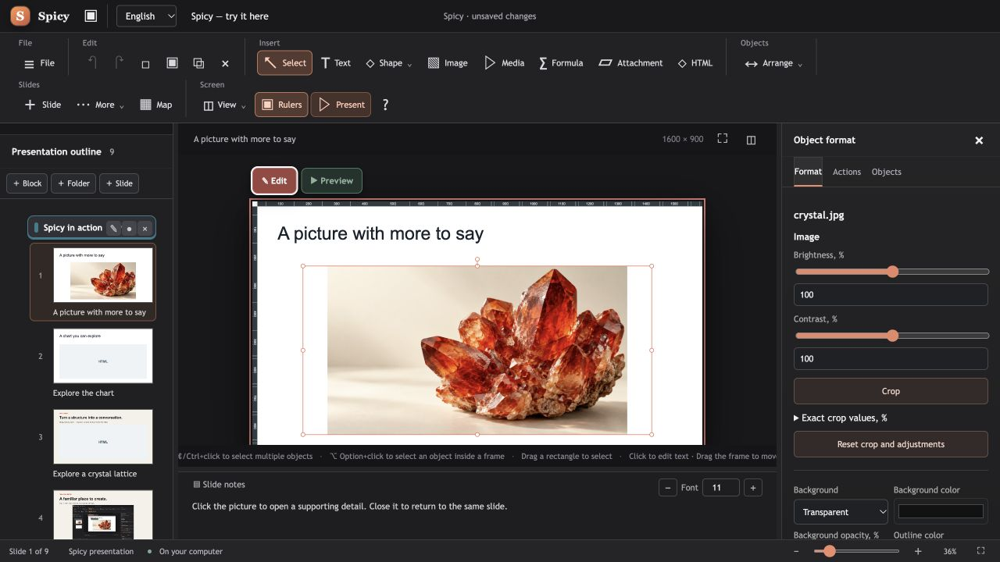

# Spicy Slides

**Presentations you can explore.**

**Share a link. Your audience opens the presentation in a browser.**

No Spicy installation is needed on the viewing computer, tablet or phone. Open the hosted HTML presentation in a modern browser and explore it there.

Create and play presentations in any Chromium-based browser — Chrome, Edge, Yandex Browser and more.

### [Try the live presentation →](https://abkuznetsov.github.io/SPICY/)

The demo runs directly inside the page. No installation or download is needed.

- **Start with Spicy Slides** — the title introduces the product and its promise.
- **On slide 2, turn the NaCl crystal**, then choose **Explore the structure** to rotate the live lattice, adjust zoom, hide ions or show multiple cells. **Go one layer deeper** opens a supporting card; **Open Wikipedia** opens a third layer with a live website and tabs. Close the layers to return to the same slide.
- **On slide 3, explore the chart**: switch views, move the slider and animate the data.
- **Keep going** for the actual editor, presenter mode, custom plugins, the ChatGPT workflow and sharing on other devices.

The chart values and crystal images are illustrative. The 3D model shows an idealized NaCl rock-salt lattice.

The Wikipedia layer requires an internet connection. Other websites can be embedded when their own settings allow it.

This presentation was created with an OpenAI GPT model and the SPICY Slides plugin.

## Thanks for the inspiration

Thank you to the creators and communities behind [reveal.js](https://revealjs.com/), [Slides.com](https://slides.com/), [Genially](https://genially.com/) and [PowerPoint](https://www.microsoft.com/en-us/microsoft-365/powerpoint). Your work inspired SPICY SLIDES and our approach to interactive presentations, details on demand and presenting in a browser.

## Why Spicy?

- **Details on demand.** Put supporting images and explanations behind a click.
- **Interaction inside the slide.** Include interactive HTML elements such as a chart with controls.
- **Keep your place.** Close a detail and return to the same slide.
- **Share in a browser.** Export a presentation as an interactive HTML file, or host it on a web page.
- **No installation for your audience.** Share the hosted presentation by link; viewers use their existing browser on a computer, tablet or phone.
- **Create and present in Chromium.** Use the same browser family to edit presentations and play them back.
- **Presenter mode.** Control slides, read speaker notes and track your time while the audience sees the presentation.
- **Custom interactive content.** Create your own HTML widgets for a chart, calculator or mini demo.
- **A ChatGPT companion.** The Spicy Slides plugin helps prepare editable `.spicy` drafts from a brief or an existing presentation. It requires a separate connection in a compatible ChatGPT workspace.

## A familiar editor

Choose a slide on the left, arrange your content on the canvas, and adjust the selected object on the right. Preview lets you try the interactions before presenting.

## Download

Installers will be published in [GitHub Releases](https://github.com/ABKuznetsov/SPICY/releases) when they are ready. No installer is available yet.

This repository currently contains the product page and presentation demo. The editor application and its source code are not included.

## Demo files

- [`docs/index.html`](docs/index.html) — the product page with the presentation embedded in it.
- [`docs/demo.html`](docs/demo.html) — the standalone presentation viewer.
- [`docs/spicy-demo.spicy`](docs/spicy-demo.spicy) — the editable sample presentation for Spicy.

GitHub Pages publishes the site from `main` → `/docs`. The README cover links to the live site; GitHub README pages do not run the embedded presentation.

## License

SPICY SLIDES is free to use, including for commercial presentations, under the [SPICY SLIDES Proprietary License](LICENSE). It is not an open-source license and does not require publication of the editor's proprietary source code.

The license reserves rights in Artem Kuznetsov's code, permits sharing your presentations and their HTML viewers, and allows independently written plugins. Redistribution, resale, rebranding and reuse of the proprietary editor code require separate permission, subject to rights preserved by applicable law.

Third-party components keep their own licenses; see [THIRD-PARTY-LICENSES.txt](THIRD-PARTY-LICENSES.txt). Earlier copies distributed under MPL-2.0 retain their applicable rights; the [previous MPL text](LICENSES/MPL-2.0-prior.txt) is preserved. The new terms do not retroactively revoke earlier licenses.

Section 6 explicitly permits inspiration from publicly observable behavior and general concepts, and independent implementation of similar features. It does not authorize copying protected code or assets or violating third-party rights. The license does not establish exclusive rights over the general idea of tabs, nested details or interactive HTML content.

© 2026 Artem Kuznetsov. SPICY SLIDES.

## ChatGPT plugin

Create editable `.spicy` presentations and independently installable `.spicy-plugin` widgets with the SPICY SLIDES ChatGPT plugin. [Installation and usage](chatgpt-plugin/INSTALL.md) · [Download version 0.2.1](chatgpt-plugin/SPICY-SLIDES-plugin-0.2.1.zip). The plugin package includes instructions and validated authoring tools; it does not include the editor application or user presentations.
