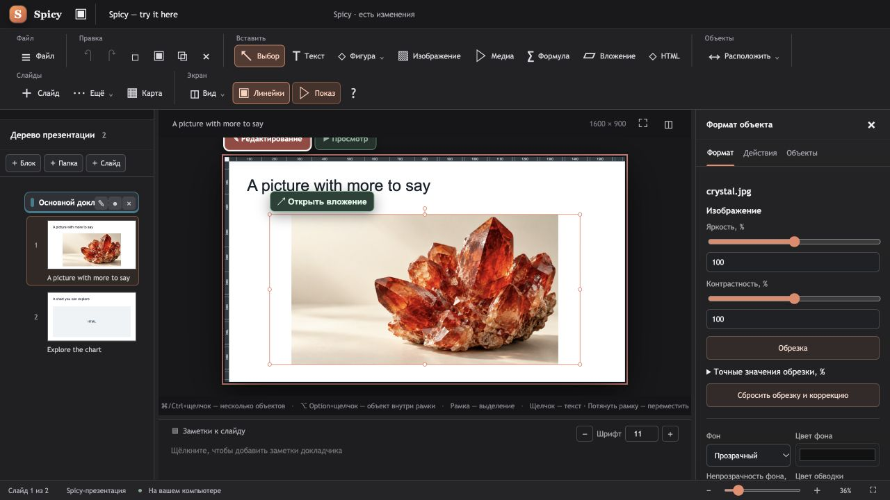

# Spicy Slides

**Presentations you can explore.**

Keep the story clear. Open the details when they matter.

### [Try the live presentation →](https://abkuznetsov.github.io/SPICY/)

The demo runs directly inside the page. No installation or download is needed.

- **Click the picture** to open an attached detail, then press Esc to return.
- **Go to the next slide** to switch chart views, move the slider and animate the data.
- **Keep going** for the actual editor, presenter mode, custom plugins and the ChatGPT workflow.

The chart values and crystal images are illustrative.

This presentation was created with an OpenAI GPT model and the SPICY Slides plugin.

## Why Spicy?

- **Details on demand.** Put supporting images and explanations behind a click.
- **Interaction inside the slide.** Include interactive HTML elements such as a chart with controls.
- **Keep your place.** Close a detail and return to the same slide.
- **Share in a browser.** Export a presentation as an interactive HTML file, or host it on a web page.
- **Presenter mode.** Control slides, read speaker notes and track your time while the audience sees the presentation.
- **Custom interactive content.** Create your own HTML widgets for a chart, calculator or mini demo.
- **A ChatGPT companion.** The Spicy Slides plugin helps prepare editable `.spicy` drafts from a brief or an existing presentation. It requires a separate connection in a compatible ChatGPT workspace.

## A familiar editor

Choose a slide on the left, arrange your content on the canvas, and adjust the selected object on the right. Preview lets you try the interactions before presenting.

## Download

Installers will be published in [GitHub Releases](https://github.com/ABKuznetsov/SPICY/releases) when they are ready. No installer is available yet.

This repository currently contains the product page and presentation demo. The editor application and its source code are not included.

## Demo files

- [`docs/index.html`](docs/index.html) — the product page with the presentation embedded in it.
- [`docs/demo.html`](docs/demo.html) — the standalone presentation viewer.
- [`docs/spicy-demo.spicy`](docs/spicy-demo.spicy) — the editable sample presentation for Spicy.

GitHub Pages publishes the site from `main` → `/docs`. The README cover links to the live site; GitHub README pages do not run the embedded presentation.

## License

See [LICENSE](LICENSE) for the Mozilla Public License 2.0.
